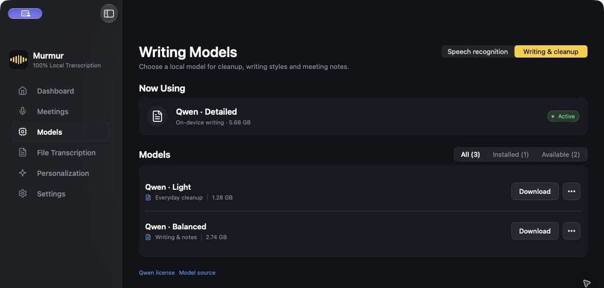
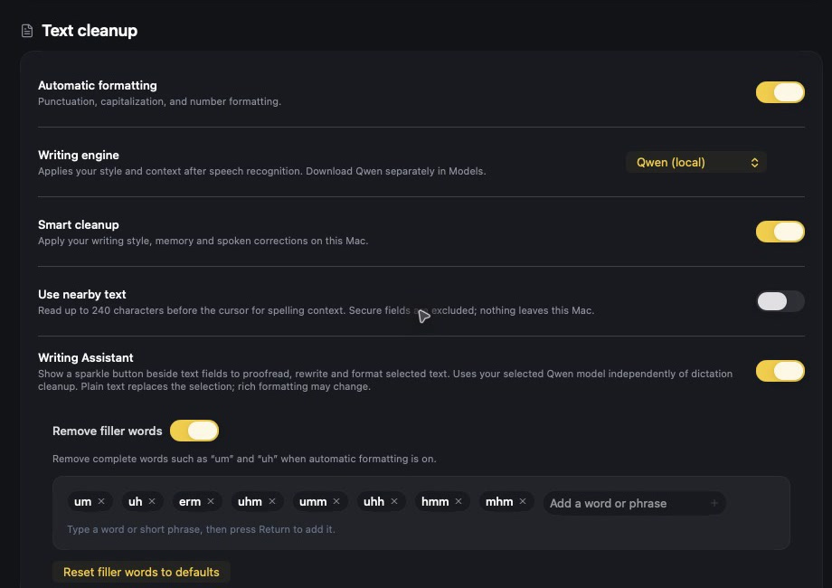
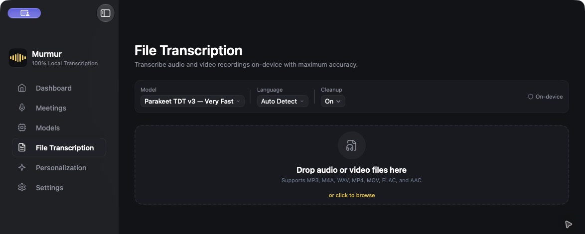

# Murmur — on-device voice dictation for Mac

**Hold a shortcut, speak naturally, and release. Murmur turns speech into clean text in the app you were using.**

Murmur is a macOS push-to-talk dictation and speech-to-text app. It combines local speech recognition with optional Qwen writing cleanup, a Writing Assistant for selected text, and audio/video file transcription. Your dictation history and downloaded models stay on your Mac.

[**Download the latest Mac DMG**](https://github.com/mohsinakbar455/Murmur/releases/download/v1.1.0/Murmur-1.1.0-arm64.dmg) · [Browse features](FEATURES.md) · [Build from source](#build-from-source)

## At a glance

- **Push-to-talk voice typing:** Hold your chosen shortcut, speak, and release to insert text into the focused app.
- **Local voice models:** Choose Apple Speech, Parakeet, or Whisper and manage downloaded models in the app.
- **Qwen writing models:** Download a writing model for smart dictation cleanup, writing styles, and meeting notes.
- **Writing Assistant:** Select existing text to proofread, rewrite, change tone, summarize, or format it.
- **File transcription:** Turn audio or video recordings into text, with optional cleanup and text or JSON export.

## See Murmur in action

### Dictation speed and activity

The dashboard shows dictated words, spoken audio, average time from releasing the shortcut to final text, and **estimated** time saved. The time-saved estimate uses your typing-speed setting; it is not a speech-recognition benchmark.


### Choose a writing model

Download a Qwen model that fits your Mac. Murmur uses the selected local model for smart cleanup, writing styles, and meeting notes. This screenshot shows the Detailed model active.



### Refine dictation and existing text

Automatic formatting handles punctuation, capitalization, numbers, and filler words. Smart cleanup applies a selected writing model to dictated text. The optional Writing Assistant works with selected text in supported apps, so you can proofread or rewrite a passage after it is written.



### Transcribe a recording

Drop an audio or video file into File Transcription, then choose the speech model, language, and whether to clean the result. Supported formats include MP3, M4A, WAV, MP4, MOV, FLAC, and AAC. Export the transcript as text or JSON.



## Download and install

Download [Murmur 1.1.0 for Apple Silicon](https://github.com/mohsinakbar455/Murmur/releases/download/v1.1.0/Murmur-1.1.0-arm64.dmg), open it, and drag Murmur to Applications. Murmur requires **macOS 26 or later** and an Apple Silicon Mac. Grant Microphone permission for speech capture and Accessibility permission for the global shortcut and text insertion. Speech and writing models download separately when selected.

The current DMG uses an ad-hoc signature and has not been notarized. If macOS stops the first launch, attempt to open Murmur once, then go to **System Settings → Privacy & Security → Open Anyway**. Only use that control if you trust this download. The [release page](https://github.com/mohsinakbar455/Murmur/releases/latest) includes the SHA-256 checksum so you can verify the file.

## Build from source

Requires macOS 26 or later and Swift 6.2 or newer. The project uses SwiftUI and Swift Package Manager.

```bash
make test      # run Swift tests
make app       # build and stage Murmur.app
make install   # install to /Applications and launch
```

Use `make` rather than a bare `swift build`: the Makefile puts build files in `~/Library/Caches/MurmurBuild`, avoiding file-provider changes during compilation. The installed bundle ID is `ai.pivotstudio.murmur`. App data lives in `~/Library/Application Support/Murmur/`; Parakeet uses FluidAudio's model cache. Model weights and personal data are not in this repository.

See the [macOS build guide](docs/BUILD_MACOS.md) for packaging details and [feature log](FEATURES.md) for a fuller tour.

## Questions

**Does dictation require a cloud account?** No. Murmur's speech and writing models run on the Mac. Some models need a one-time download before first use.

**What does “speed” mean on the dashboard?** It reports average release-to-text time from your dictations and a separate time-saved estimate based on your configured typing speed.

**Can I transcribe an existing recording?** Yes. File Transcription accepts common audio and video formats and exports text or JSON.

## Rights

This public repository does not grant an open-source license. All rights reserved.
